# StrideLab — Endurance Running Performance Analyst

[](https://github.com/AKHydros/stridelab/actions/workflows/deploy.yml)
[](LICENSE)

**An evidence-based race-debrief and marathon-preparation app for runners, with a Liquid Glass interface.**

**Live app:** https://akhydros.github.io/stridelab/ (published by GitHub Actions once Pages is enabled).

StrideLab turns your Garmin exports or **FIT files**, your Stryd power data, up to **six months of Garmin Connect and Strava history**, your **HRV and sleep** data and a GPS route into a professional, coach-style performance debrief. It checks and reconciles the data, computes the pacing, heart-rate, power and training-load metrics, draws the five required graphs, and cross-checks how you *felt* against what was *recorded*. It then plans your marathon: taper, course, wind, heat and fuelling.

It is built from the **Endurance Running Performance Analyst master prompt** ([`docs/MASTER_PROMPT.md`](docs/MASTER_PROMPT.md)). The app runs that prompt's arithmetic as a deterministic, unit-tested engine. You can also send the validated results to Claude for a narrative debrief written to the same specification.

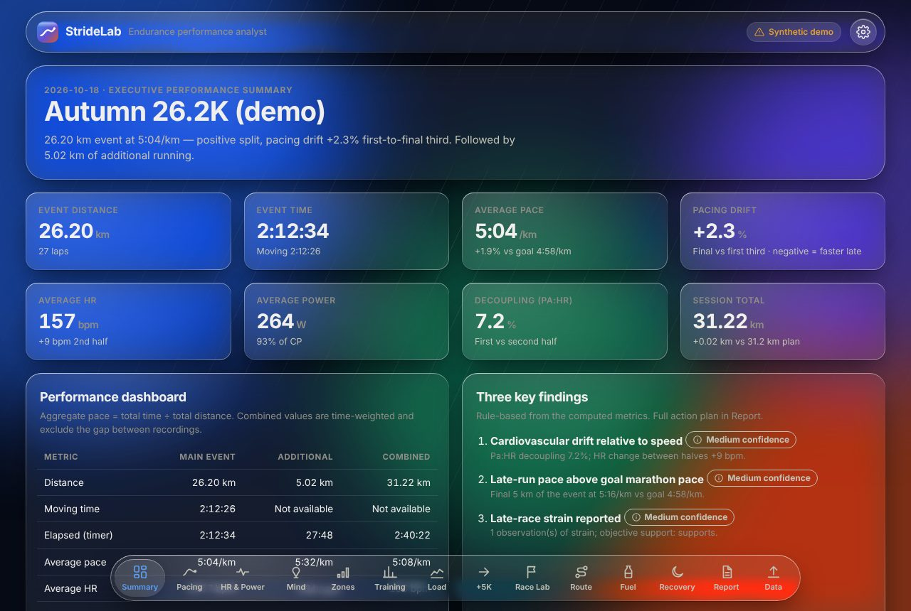

| Pacing (Graph 1 & 3) | HR & Power (Graph 2) | Training (Graph 4) |
|---|---|---|
| 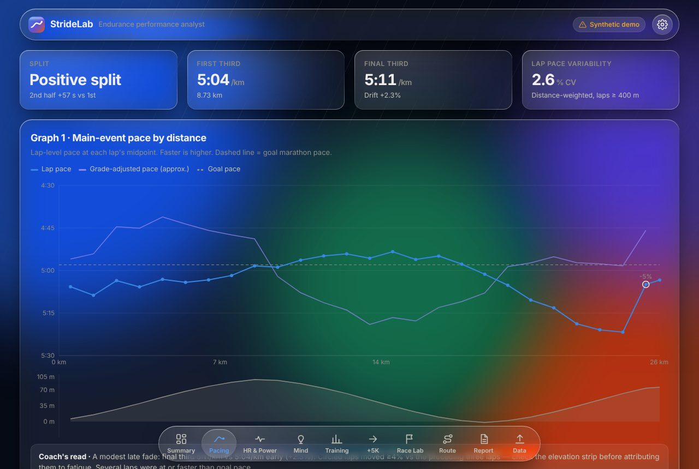 | 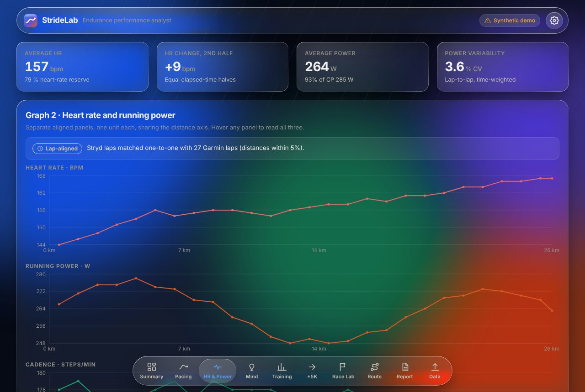 | 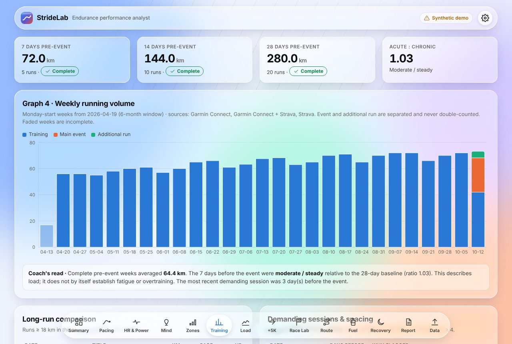 |

| Zones | Load & curves (GoldenCheetah-style) |
|---|---|
| 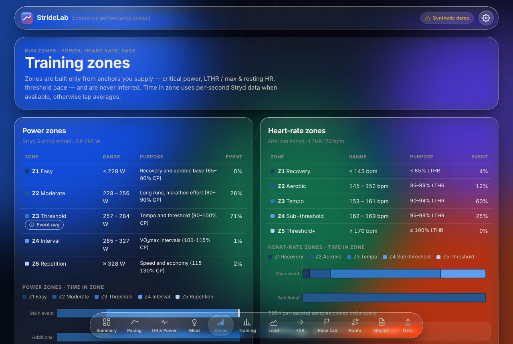 | 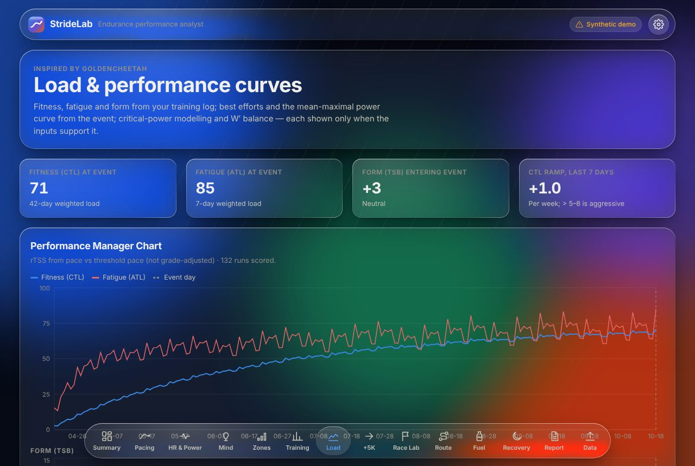 |

| Recovery (HRV, sleep) | Carb-load simulator | Race Lab |
|---|---|---|
| 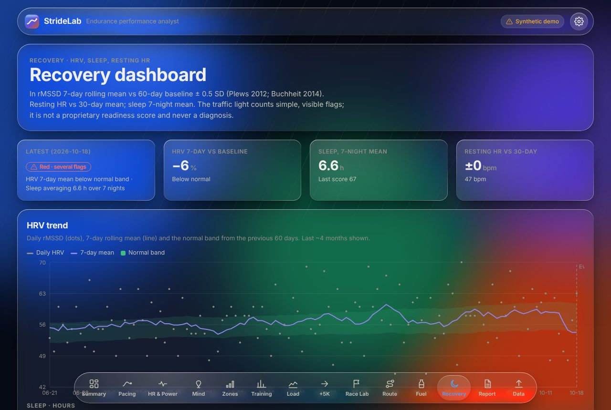 | 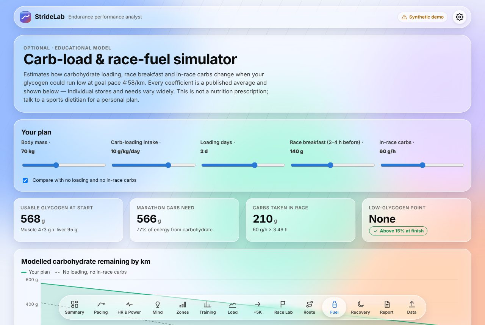 | 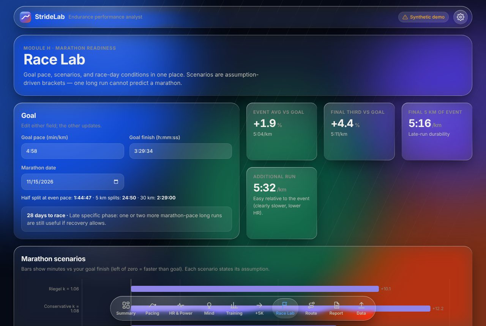 |

| Report | iPhone |
|---|---|
| 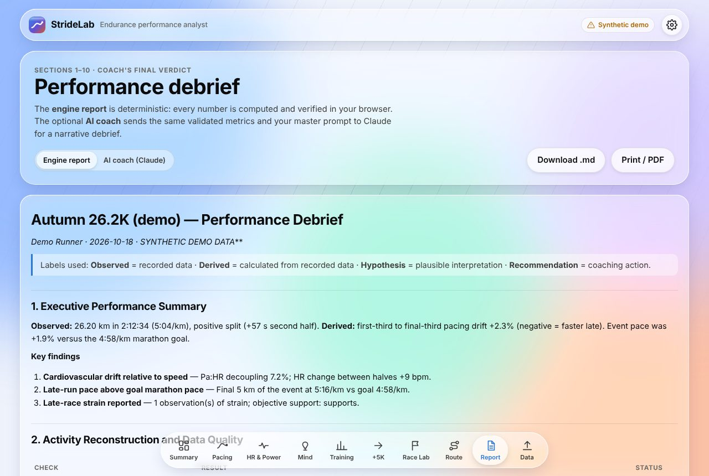 | 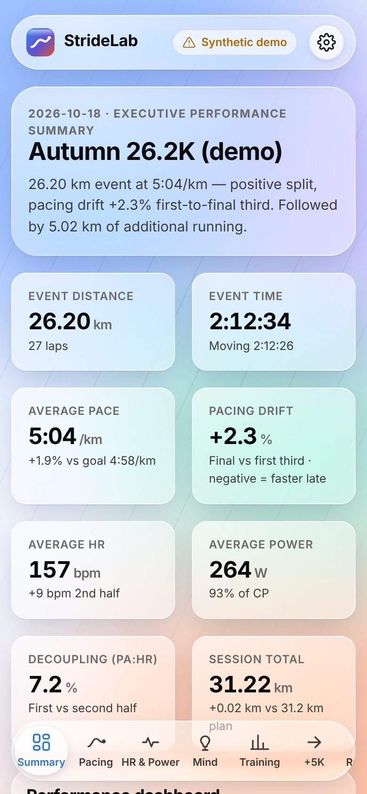 |

> Screenshots use the bundled **synthetic demo data**. It is made up for illustration and is not any real athlete's results.

---

## Contents

- [Features](#features)
- [Quick start](#quick-start)
- [Importing your data](#importing-your-data)
- [How the analysis works](#how-the-analysis-works)
- [The Liquid Glass design system](#the-liquid-glass-design-system)
- [AI coach (optional)](#ai-coach-optional)
- [Architecture](#architecture)
- [Testing](#testing)
- [Deploying to GitHub Pages](#deploying-to-github-pages)
- [Privacy](#privacy)
- [Roadmap](#roadmap)
- [Limitations & disclaimer](#limitations--disclaimer)
- [License](#license)
- [Credits & references](#credits--references)

---

## Features

### Each tab covers one module of the master prompt

| Tab | Master-prompt module | What you get |
|---|---|---|
| **Summary** | A · Executive assessment, §2 data quality | KPI tiles; a side-by-side table of main event, additional run and combined session; the three key findings; a reconciliation log (lap sums vs the device summary row, Stryd vs Garmin distance, de-duplication, recorded vs planned 31.2 km) |
| **Pacing** | B · Pacing & execution | **Graph 1** (pace by distance with faster pace plotted higher, the goal line, grade-adjusted pace and circled pace changes ≥ 4 %); elevation strip; **Graph 3** (first third vs final third: % change in pace, GAP, HR, power and cadence); a 5 km segment table; split type; drift; pace CV |
| **HR & Power** | C · Physiology, D · Stryd power | **Graph 2** (aligned single-unit panels for HR, power and cadence, with no dual axes); aerobic decoupling (Pa:HR and Pw:HR) with the method stated; HR drift; %HRR or %HRmax; avg/normalised power, VI, %CP, speed-per-watt, running effectiveness, form power, LSS and GCT trends; an explicit note on how Stryd data was aligned to the laps |
| **Mind** | E · Subjective vs objective | Each athlete note is placed on its lap and checked against that lap's pace (vs the event and the three laps before it), HR and power. It is then classed as *Supports*, *Partially supports*, *Cannot substantiate* or *Context only*, with the coaching implication |
| **Zones** | C/D extended | **Run zones** in three systems, each built only from anchors you supply: Stryd 5-zone **power** (% CP), **heart rate** (Friel %LTHR, else Karvonen %HRR, else %HRmax) and **pace** (% of threshold pace). Shows time in zone for the event and the additional run (per-second when Stryd samples exist) and which zone your goal pace falls in |
| **Training** | F · Training & fatigue | Up to **6 months** of merged Garmin Connect + Strava history with sources shown; 7/14/28-day pre-event totals with complete or partial status; acute:chronic ratio; **Graph 4** (weekly volume stacked as training, event and additional run, with incomplete weeks faded); long-run comparison; demanding sessions and how they were spaced |
| **Load** | F extended (GoldenCheetah-style) | **Performance Manager Chart** (CTL fitness, ATL fatigue, TSB form) from rTSS or TRIMP, plus CTL ramp rate; **best efforts** (1 km / 5 km / 10 km / half) inside the event; **mean-maximal power curve**; a **two-parameter CP/W′ model** that refuses to report implausible fits; **W′ balance** (Skiba) through the event; **taper simulator** that projects CTL/ATL/TSB to race day from weekly load percentages, with presets and a "suggest" search for the highest fitness that still lands form at +5 to +15 |
| **+5K** | G · Additional run | **Graph 5** (event and additional run on one elapsed-time axis, with the unrecorded gap shaded and lines never joined across it); an easy, moderate or demanding classification; reconciliation against the 31.2 km plan |
| **Race Lab** | H · Marathon readiness | Goal pace ↔ finish-time calculator; taper-phase guidance from days-to-race; three labelled **marathon scenarios** (Riegel 1.06, conservative 1.08, durability-weighted); **live race-day weather** (Open-Meteo forecast or historical archive) with a heat-adjusted goal pace and wind guidance |
| **Route** | — (new) | GPX/TCX (or the event FIT's GPS) map coloured by grade, elevation profile and a **course-aware pacing plan** (PacePro-style) that blends even pace and even effort and includes the heat adjustment and a **wind-aware** adjustment (forecast wind direction vs the course bearing of each km, with an exposure/drafting slider) |
| **Fuel** | §7 fuelling (optional) | **Carb-load & race-fuel simulator**: loading g/kg/day and days, race breakfast and in-race g/h → modelled glycogen remaining by km vs a no-fuelling baseline, with every assumption listed |
| **Recovery** | F extended | **HRV, sleep and resting-HR dashboard**: 7-day ln rMSSD vs a 60-day normal band, traffic-light flags, pre-event recovery summary, **training load vs next-morning HRV** (scatter + Pearson r) and **run efficiency after good vs poor sleep/HRV** |
| **Report** | §9 report structure | The full 10-section debrief, the *Coach's Final Verdict* and *Data Required* list. Download it as Markdown or print it to PDF. Optional **AI coach** mode |
| **Data** | §3–4 inputs & validation | Drag-and-drop import of spreadsheets **or FIT files**; separate **Garmin Connect** and **Strava** history uploads (CSV, many FIT/GPX, or a whole export ZIP); recovery files; route; unit auto-detection; athlete context form (CP, LTHR, max/rest HR, threshold pace, W′); event-date detection |

### Built-in rules from the master prompt

- Aggregate pace is always **total time ÷ total distance**, never the mean of the lap paces.
- HR, power and cadence averages are **time-weighted**, and coverage is tracked.
- The event, the additional run and the combined session are **kept separate**. Combined HR and power are time-weighted across both recordings, and combined elapsed time excludes the gap between them.
- The pre-event walk is **context only**. It is never counted as running distance.
- Missing data shows as **"Not available"** or **"Insufficient data"**. Nothing is estimated without support.
- Each finding carries its **evidence** and a **High / Medium / Low confidence** rating. The action plan is capped at **five** items.
- Report text keeps **observed**, **derived**, **hypothesis** and **recommendation** visibly apart.

---

## Quick start

Requirements: **Node.js 20+** and npm.

```bash
git clone https://github.com/AKHydros/stridelab.git
cd stridelab
npm install
npm run dev          # http://localhost:5173
```

Open the app and click **Load synthetic demo** to explore it, or drop in your own files on the **Data** tab. The [`sample-data/`](sample-data) folder has synthetic files in the real Garmin, Strava and Stryd export layouts (CSV, FIT, Strava ZIP, recovery CSV, GPX), so you can test every import path end to end.

| Script | Purpose |
|---|---|
| `npm run dev` | Development server with hot reload |
| `npm test` | Run the Vitest suite (analytics engine and parsers) |
| `npm run typecheck` | Strict TypeScript check |
| `npm run build` | Type-check and produce a static production build in `dist/` |
| `npm run preview` | Serve the production build locally |
| `npm run samples` | Regenerate `sample-data/` (incl. FIT files written with Garmin's FIT SDK) from the demo |

**Install on iPhone or Android:** open the deployed site in Safari or Chrome, then choose **Share → Add to Home Screen**. It launches full-screen like a native app.

---

## Importing your data

All parsing happens **in your browser**. Spreadsheet slots accept CSV, TSV or XLSX. For multi-sheet workbooks, StrideLab picks the sheet whose headers best match what it expects (for example, *Sheet 4* of an activity workbook). A title row above the headers is skipped automatically. Activity slots also accept Garmin **`.fit`** (and `.fit.gz`) files, decoded with Garmin's official [FIT JavaScript SDK](https://developer.garmin.com/fit/). FIT files give time-aligned, second-by-second HR, power, speed, cadence and GPS.

| Slot | Typical source | Recognised columns (case-insensitive, aliases accepted) |
|---|---|---|
| **1 · Garmin Split Analysis** | Garmin Connect → activity → *Splits* → export | `Laps/Split`, `Time`, `Moving Time`, `Distance`, `Avg Pace`, `Avg HR`, `Max HR`, `Total Ascent/Descent`, `Avg Power`, `Avg Run Cadence`, `Avg Ground Contact Time`, `Avg Stride Length`, `Avg Vertical Oscillation`, `Avg Temperature`, **`Notes/Comments/Observations`**. A `Summary` row is kept for reconciliation. Free-text rows become observations |
| **2 · Stryd Analysis** | Stryd PowerCenter lap table **or** per-second CSV | Laps: `Lap`, `Time`, `Distance`, `Power`, `Form Power`, `Leg Spring Stiffness`, `Cadence`. Per-second data: `Timestamp`, `Stryd Distance (meters)`, `Watts`, `Stryd Speed`, `Heart Rate`, … **Critical Power** is read from a `CP` column or a title row such as `CP: 285 W` |
| **1 / 4 as FIT** | Garmin Connect → activity → ⚙ → *Export Original* (or the watch's `GARMIN/Activity` folder) | Lap, record (1 Hz) and session messages; running cadence converted from strides/min to steps/min; GPS becomes the route automatically |
| **3a · Garmin Connect history** | *Activities* → Export CSV, **and/or** many `.fit`/`.gpx` files | `Activity Type`, `Date`, `Title`, `Distance`, `Time`, `Moving Time`, `Avg HR`, `Max HR`, `Avg Run Cadence`, `Avg Power`, `Total Ascent`, `Aerobic TE`. Non-running activities are excluded |
| **3b · Strava history** | Strava → Settings → My Account → *Download or Delete Your Account* → **export ZIP** (or its `activities.csv`, or `.fit`/`.gpx` files) | `Activity Date`, `Activity Name`, `Activity Type`, `Elapsed Time`, `Moving Time`, `Distance`, `Average Heart Rate`, `Average Watts`. A ZIP without `activities.csv` is scanned for FIT/GPX files |
| **4 · Additional 5K splits** | Same format as slot 1 | Same columns as slot 1 |
| **Recovery** *(optional)* | Garmin Connect *HRV Status* and *Sleep* exports, Oura, Whoop, or any CSV | `Date`, `Overnight HRV`/`HRV (ms)`/`rMSSD`, `Resting Heart Rate`, `Sleep Duration` (`7h 32min`, `7:32`, minutes or seconds), `Sleep Score`, `Readiness/Recovery score`. Several files merge by date |
| **Route** *(optional)* | GPX (`trkpt` or `rtept`) or TCX | Latitude, longitude, elevation, time, HR and cadence extensions |

**Six months, two sources, no duplicates.** Garmin Connect and Strava are uploaded separately and merged: runs on the same day with distances within 3 % are treated as one activity, keeping the richer record and labelling it `Garmin Connect + Strava`. Only the **182 days before the event** (plus anything up to race day) are used, and the app reports how many older runs it left out.

**Units.** Distances in miles (`(mi)` or `/mi` headers) are detected and converted. Use the *km / mi* toggle if your headers are ambiguous. Spreadsheet duration cells (stored as fractions of a day) are converted to seconds.

**No double-counting.** If the activity summary already contains the event or the additional run (same day, distance within 5 %), those rows are tagged and not added a second time. If they are missing, the runs are added from their own files and marked as such.

**Event date.** If a same-distance run is found in the activity summary, the app offers to set the event date from it. Pre-event windows depend on that date.

---

## How the analysis works

All formulas live in `src/lib/analysis/` and are covered by tests.

| Metric | Definition |
|---|---|
| Aggregate pace | Σ time ÷ Σ distance |
| Segments (0–5 km, …) | Laps are apportioned at segment boundaries, assuming uniform pace within the lap. Apportioned segments are flagged with `*` |
| Pacing drift | (final-third pace − first-third pace) ÷ first-third pace × 100, distance-weighted. **Negative means faster late** |
| Split type | Second-half time − first-half time; within ±1 % counts as "even" |
| Pace variability | Distance-weighted coefficient of variation of lap pace (laps ≥ 400 m) |
| Pace changes | Laps whose pace differs ≥ 4 % from the mean of the preceding three laps |
| Grade-adjusted pace | Minetti et al. (2002) energy cost of running on a slope, applied to net lap grade, with downhill benefit capped |
| Aerobic decoupling | Friel's Pa:HR (and Pw:HR): efficiency factor (output ÷ HR) in the first vs second half of elapsed time. Needs ≥ 45 min and HR on ≥ 90 % of the time |
| Relative intensity | Karvonen %HRR when max and resting HR are supplied, otherwise %HRmax |
| Normalised power, VI | 30 s rolling mean → 4th power → mean → 4th root (needs ~1 Hz samples). VI = NP ÷ average |
| Speed per watt | (m/s ÷ W) × 100, first vs final third. Shown as a description, not as proof of mechanics |
| Running effectiveness | Speed ÷ (W/kg). Needs body mass |
| Stryd ↔ Garmin alignment | One-to-one when lap counts and distances agree (within 5 %). Otherwise mapped by distance fraction and labelled **approximate** |
| Pre-event windows | Running km in the 7/14/28 days **before** the event day. *Partial* if records start inside the window |
| Acute:chronic | 7-day km ÷ (28-day km ÷ 4). Descriptive only |
| Marathon scenarios | Riegel (1981) T₂ = T₁·(D₂/D₁)^k with k = 1.06 and 1.08, plus a durability-weighted case (event pace for the event distance, then final-third pace +3 %). **Scenarios, not predictions** |
| Heat adjustment | Temperature + dew point (°F) rule of thumb, interpolated (≤ 100 → 0 %, 171–180 → 8–10 %). Dew point from the Magnus formula |
| Power zones | Stryd: Z1 < 80 %, Z2 80–90 %, Z3 90–100 %, Z4 100–115 %, Z5 ≥ 115 % of CP |
| HR zones | Friel run zones by %LTHR (< 85, 85–89, 90–94, 95–99, ≥ 100), else Karvonen %HRR (50/60/70/80/90 %), else %HRmax |
| Pace zones | Pace time as % of threshold pace: > 129 %, 114–129 %, 106–113 %, 99–105 %, < 99 % |
| Time in zone | 1 Hz samples binned per second; otherwise each lap's time goes to the zone of its average (labelled) |
| rTSS | hours × (threshold pace ÷ run pace)² × 100 (not grade-adjusted) |
| TRIMP (fallback) | Banister: minutes × HRr × 0.64·e^(1.92·HRr) |
| CTL / ATL / TSB | Exponentially weighted daily load, time constants 42 and 7 days; TSB = yesterday's CTL − ATL |
| Best efforts | Fastest continuous span of each distance on the lap-implied distance→time curve (0.05 km search step) |
| Mean-maximal power | Best rolling average power per duration (prefix sums over 1 Hz samples); coarse lap version otherwise |
| CP / W′ model | Linear fit of work = CP·t + W′ over 3–20 min mean-max points; rejected if W′ is outside 8–40 kJ |
| W′ balance | Skiba (2015) differential model: 1 J depleted per J above CP; below CP, recovery ∝ (CP − P)·(W′ − W′bal)/W′ |
| Course plan | Split pace ∝ (Minetti cost factor × wind factor)^effort, normalised so the splits add up exactly to the target time |
| Wind factor | Headwind = wind × 0.6 (runner height) × exposure × cos(wind-from − course bearing). Cost = 1 + 0.04·((v+h)\|v+h\| − v²)/v² (air resistance ≈ 4 % of cost at marathon speed; Pugh 1971, Davies 1980); tailwind benefit halved |
| Taper simulator | Baseline = mean daily load of the 4 weeks before the event × 7; each future day = baseline × week % × weekday share; CTL/ATL continue with the same 42/7-day constants. "Suggest" grid-searches the last 3 weeks (5 % steps) for max race-day CTL with TSB in [+5, +15] |
| Carb-load model | Usable glycogen = mass × (6 g/kg + loading gain ≤ 3 g/kg) × 0.75 + liver (60 g + ¼ of breakfast, ≤ 110 g); need per km = mass × 1 kcal/kg/km × CHO share ÷ 4; CHO share = 0.45 + 1.3 × (threshold speed ratio − 0.7), clamped 40–90 %; intake capped at 90 g/h |
| HRV status | ln rMSSD 7-day mean vs previous-60-day mean ± 0.5 SD (Plews 2012; Buchheit 2014); needs ≥ 4 and ≥ 14 values |
| Recovery flags | HRV below band · resting HR ≥ +5 bpm vs 30-day mean · 7-night sleep < 7 h → green (0) / amber (1) / red (≥ 2) |
| Load ↔ recovery | Pearson r between daily load and next-morning HRV % from baseline (n ≥ 8); aerobic efficiency (m/min per bpm) of runs after good vs poor nights (≥ 5 runs per group) |

The rule-based **coach findings** (`buildFindings`) fire on these metrics. Examples: drift above 3 %, decoupling of 5 % or more, lap power CV above 5 %, final 5 km slower than goal pace, reported strain, the warm-up note, an acute load spike, the race within 21 days, and missing fuelling data. Each finding includes the numbers that triggered it.

---

## The Liquid Glass design system

The interface draws on Apple's *Liquid Glass* design language and is built for the web with no native dependencies (`src/styles/app.css`, `src/components/glass/`):

- **Material:** translucent tint + `backdrop-filter: blur() saturate()` over a slowly drifting, colourful backdrop.
- **Rim light:** a masked gradient hairline that is brighter where light hits the edge.
- **Specular highlight:** a radial sheen that follows the pointer (CSS custom properties updated on `pointermove`).
- **Refraction:** an SVG `feTurbulence` + `feDisplacementMap` filter used *inside* `backdrop-filter` on controls (top bar, tab bar), so the content behind visibly bends. As on iOS, the lens is kept for controls and isn't used on content.
- **Floating tab bar:** a capsule with a springy liquid indicator that slides between tabs.
- **Adaptive:** light and dark themes (auto or manual), safe-area insets, a phone-first layout, and print styles for the report.
- **Accessible fallbacks:** refraction only on Chromium (others get frosted glass); `prefers-reduced-transparency` → solid surfaces; `prefers-reduced-motion` → no animation. A *Material* setting (Liquid / Frosted / Solid) lets you choose manually.

**Charts** use a validated, colour-vision-deficiency-safe categorical palette with separate light and dark steps. Every chart has one unit per axis (no dual axes), glass tooltips, legends, and a *Coach's read* interpretation below it, as the master prompt requires.

---

## AI coach (optional)

The **Report → AI coach** mode sends a single request to the Claude API:

- **System prompt:** your master prompt, verbatim (`docs/MASTER_PROMPT.md`).
- **User turn:** the athlete context, normalised lap tables for all four files, the training log, and the engine's **validated metrics** as JSON. The model is told to treat these values as the arithmetic source of truth, so the narrative and the numbers agree.
- **Model:** `claude-opus-5-5`, with adaptive thinking and `effort: high`, streamed into the page. Server-side refusal fallback (`fallbacks: "default"`) is enabled.

You enter your own Anthropic API key. It is held in **session storage for this tab only** and sent directly to `api.anthropic.com`. This suits personal use. For a shared or public deployment, move the call into a small server or edge function so the key never reaches browsers.

---

## Architecture

```
stridelab/
├── docs/
│   ├── MASTER_PROMPT.md        # The analyst specification (also the AI system prompt)
│   └── screenshots/
├── sample-data/                # Synthetic files in Garmin/Stryd export layouts
├── src/
│   ├── lib/
│   │   ├── types.ts            # Normalised data model (km, s, s/km, bpm, W)
│   │   ├── units.ts            # Parsing/formatting durations, paces, dates
│   │   ├── parse/              # table (CSV/XLSX), laps, stryd, training, gpx,
│   │   │                       # fit (Garmin SDK), history (Garmin/Strava/ZIP merge), recovery
│   │   ├── analysis/           # aggregate, pacing, physiology, power, training,
│   │   │                       # environment, readiness, coursePlan, commentary,
│   │   │                       # zones, load (PMC, best efforts, MMP, CP, W′bal),
│   │   │                       # taper, wind, fuel, recovery,
│   │   │                       # analyze (orchestrator + findings)
│   │   ├── report/markdown.ts  # Deterministic 10-section report
│   │   ├── ai/coach.ts         # Claude integration
│   │   ├── weather.ts          # Open-Meteo geocoding/forecast/archive
│   │   ├── demo.ts             # Synthetic demo session
│   │   └── store.ts            # Safe localStorage persistence
│   ├── components/             # Glass primitives, tab bar, charts, Markdown renderer
│   ├── views/                  # One file per tab
│   └── styles/app.css          # Liquid Glass design tokens and components
├── scripts/                    # FIT fixture builder and sample-data generator
└── tests/                      # Vitest: engine, parsers, sample-data end-to-end
```

**Stack:** React 18 · TypeScript (strict) · Vite 6 · Recharts · Leaflet / OpenStreetMap · PapaParse · read-excel-file · Garmin FIT SDK · fflate · Anthropic TypeScript SDK · Vitest. There is no backend: the build is a static site.

---

## Testing

```bash
npm test
```

The suite covers aggregate pace vs mean lap pace, time-weighting, lap slicing, the drift sign convention, 5 km segmentation, decoupling, normalised power, Stryd alignment, event de-duplication, the 7/14/28-day windows, Monday-start weeks, Riegel, the heat model, dew point, grade cost, course-plan totals, commentary classification, the parsers (summary row, notes, miles, title rows, per-second Stryd, CP in a title row, non-running exclusion), zones and time in zone, rTSS/TRIMP, PMC sign conventions, best efforts, mean-max monotonicity, CP/W′ recovery on ideal data (and rejection of implausible fits), W′ balance, FIT decoding (files written with Garmin's encoder), Strava ZIP and multi-FIT history, cross-source de-duplication and the 6-month window, recovery parsing (Garmin, Whoop and sleep-duration formats) and HRV status, the taper simulator and its suggestion, the carb model, wind bearing/headwind asymmetry and wind-aware plan totals, and an **end-to-end run on every file in `sample-data/`**.

---

## Deploying to GitHub Pages

The repository includes `.github/workflows/deploy.yml`. On every push or pull request it installs, type-checks, tests and builds. On pushes to `main` it also deploys `dist/` to GitHub Pages.

1. Push the repository to GitHub.
2. Go to **Settings → Pages → Build and deployment → Source: GitHub Actions**.
3. Push to `main`. The site will be published at `https://<user>.github.io/<repo>/`.

The build uses relative asset paths (`base: "./"`), so it works from any sub-path.

---

## Privacy

- Spreadsheets, FIT files, export ZIPs, recovery data and routes are parsed locally. The parsed session is saved in your browser's `localStorage` so it survives a reload. **Clear session** removes it.
- Network calls happen only when you ask for them: OpenStreetMap tiles (Route tab), Open-Meteo (weather search) and, if you use it, the Claude API.

---

## Roadmap

Ideas drawn from the leading running platforms (Garmin Connect, Strava, Stryd PowerCenter, COROS, TrainingPeaks, Runalyze, Final Surge):

Shipped from the original roadmap: FIT import, separate Garmin Connect / Strava history (6 months), taper simulator, wind-aware course plan, carb-load simulator and the HRV/sleep recovery dashboard.

Next:

1. **Direct Strava / Garmin Connect sync:** OAuth through a small serverless function instead of manual exports (both APIs require a server-side client secret).
2. **Season power-duration curve:** mean-maximal power across *all* runs (as GoldenCheetah does) so the CP/W′ fit uses genuine all-out efforts, and the marathon can be planned as a %CP target.
3. **Fluid & sodium planner:** sweat-rate test input and temperature-based fluid needs, with gel and bottle timing on the course map.
4. **Apple Health import:** read `export.zip` from the Health app for HRV, sleep and workouts.
5. **Shoe mileage and injury-risk flags:** gear tracking and ramp-rate alerts.
6. **Native iOS app:** SwiftUI with the system `glassEffect` material (iOS 26), HealthKit and a Live Activity race view on Apple Watch.
7. **Coach sharing:** a read-only share link and comment threads on each finding.

---

## Limitations & disclaimer

- Lap-level data limits resolution. Segment boundaries inside a lap, the halves used for decoupling, and GAP from net lap grade are **approximations** and are labelled as such.
- Garmin and Stryd devices are not time-synchronised. Sample-level alignment is by distance fraction.
- Commentary classification is a **keyword-and-metric heuristic** for a coach to review.
- Heat, wind, course, taper and carbohydrate models are published **rules of thumb and averages**. Individual responses vary, and the fuel simulator is not a nutrition prescription.
- Recovery correlations show **association, not causation**; illness, alcohol, travel and life stress also move HRV and sleep.
- Marathon scenarios are **not predictions**. One long run cannot establish marathon capability.
- StrideLab is a training-analysis tool, **not medical advice**. Nothing in it diagnoses a medical condition.

---

## License

[MIT](LICENSE) © 2026 AKHydros. The Garmin FIT SDK dependency is distributed under Garmin's FIT Protocol License.

---

## Credits & references

- Minetti, A. E. et al. (2002). *Energy cost of walking and running at extreme uphill and downhill slopes.* J Appl Physiol 93:1039–1046.
- Riegel, P. S. (1981). *Athletic records and human endurance.* American Scientist 69:285–290.
- Friel, J. *Aerobic decoupling* (Pa:HR / Pw:HR), TrainingPeaks.
- Karvonen, M. J. et al. (1957). Heart-rate reserve method.
- Banister, E. W. (1991). Impulse-response model / TRIMP. Monod, H. & Scherrer, J. (1965). Critical power. Skiba, P. F. et al. (2015). W′ balance (differential model).
- Feature ideas from [GoldenCheetah](https://www.goldencheetah.org) (open-source performance software), Stryd and TrainingPeaks. Friel, J. *The Triathlete's Training Bible* (run zones).
- Mujika, I. & Padilla, S. (2003); Bosquet, L. et al. (2007). Tapering meta-analysis. Plews, D. et al. (2012); Buchheit, M. (2014). HRV-guided monitoring. Pugh, L. (1971); Davies, C. (1980). Air resistance in running. Burke, L. et al. (2011); Jeukendrup, A. (2014); Rapoport, B. (2010). Carbohydrate needs in endurance events.
- Garmin [FIT SDK](https://developer.garmin.com/fit/) for FIT decoding; [fflate](https://github.com/101arrowz/fflate) for ZIP/GZIP.
- Weather data: [Open-Meteo](https://open-meteo.com) (CC BY 4.0). Map data © [OpenStreetMap](https://www.openstreetmap.org/copyright) contributors.
- *Liquid Glass* is Apple's design language. This project is an independent web interpretation and is not affiliated with Apple, Garmin, Stryd or Strava.
